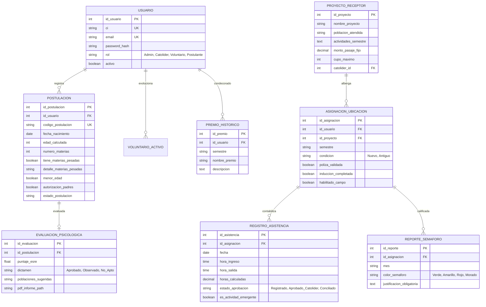
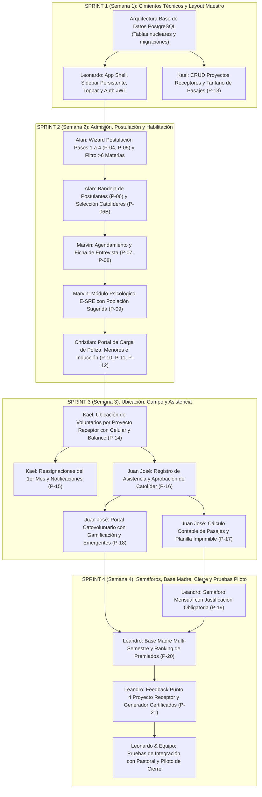

# ESPECIFICACIONES TÉCNICAS ACTUALIZADAS DE MOCKUPS Y SISTEMA WEB CATOVOLUNTARIOS
**Fase de Especificación y Diseño UI/UX — Post-Reunión Contraparte Pastoral UCB**  
*Universidad Católica Boliviana "San Pablo" — Regional La Paz*  
*Carrera de Ingeniería de Sistemas — Proyecto Social Programa Catovoluntarios*  
*Fecha de actualización: 18 de Noviembre de 2026*

---

## 1. CONTROL DE CAMBIOS Y CONVENCIONES DEL SISTEMA

El presente documento consolida y actualiza formalmente los requerimientos, campos, módulos y funcionalidades técnicas de las **21 pantallas del sistema (P-01 a P-21)** más la pantalla complementaria de **Selección de Catolíderes (P-06B)**, incorporando la totalidad de observaciones, acuerdos y precisiones emitidas por la **Lic. Andrea Moscoso (Coordinadora de Pastoral UCB)** durante la sesión de revisión de mockups.

### 1.1 Convenciones de Nomenclatura Institucional Aprobadas
A solicitud expresa de la contraparte, se homologa la terminología en toda la interfaz de usuario, endpoints y modelo de datos:
1. **Proyecto Receptor:** Reemplaza definitivamente el término *"Institución Aliada"*. Representa cada uno de los centros o convenios activos (ej. Hogar San Ramón, Comedor San Calixto, etc.).
2. **Ubicación de Voluntarios:** Denominación oficial del proceso de emparejamiento (*Matching*) entre el postulante admitido y el proyecto receptor.
3. **Ciclo de 4 Etapas del Voluntariado:**
   * **Etapa 1: Convocatoria** (Difusión, inducción general, webinars).
   * **Etapa 2: Postulación y Selección** (Formulario web, entrevistas por Catolíderes y prueba psicotécnica E-SRE).
   * **Etapa 3: Ubicación de Voluntarios** (Distribución equilibrada por carreras, edades y proyectos receptores).
   * **Etapa 4: Desarrollo del Voluntariado** (Ejecución de jornadas en campo, control de asistencia, reposición de pasajes y actividades emergentes).

### 1.2 Código Cromático Oficial por Rol de Usuario (Badges y Tags de UI)
Para evitar confusiones en vistas compartidas y bandejas de gestión, se estandarizan los colores semánticos por rol:
* 🟨 **Catovoluntario Activo:** Amarillo (`#EAB308` / badge: fondo `#FEF9C3`, texto `#854D0E`).
* 🟥 **Catolíder:** Rojo (`#EF4444` / badge: fondo `#FEE2E2`, texto `#991B1B`).
* 🟦 **Postulante en Proceso:** Azul (`#2563EB` / badge: fondo `#DBEAFE`, texto `#1E40AF`).
* 🩵 **Interesado (Visitante / Sin postulación):** Celeste (`#0EA5E9` / badge: fondo `#E0F2FE`, texto `#0369A1`).
* 🟩 **Administración Pastoral / Docente:** Verde (`#10B981` / badge: fondo `#D1FAE5`, texto `#065F46`).

---

## 2. ESPECIFICACIONES TÉCNICAS DETALLADAS POR MOCKUP (P-01 A P-21 + P-06B)

---

### MÓDULO 01: PORTAL PÚBLICO, AUTENTICACIÓN Y APP SHELL MAESTRO
**Responsable Técnico:** Leonardo Delgado Medrano

#### P-01: Landing Pública de Convocatoria
* **Requerimientos cubiertos:** RF-01 (Portal de Convocatoria Semestral).
* **Observaciones de la contraparte:**
  * *"Menos es más. La versión anterior tenía demasiado texto y ahuyenta a los chicos de primeros semestres que son los que más postulan"*.
  * No mostrar todo el cronograma detallado ni saturar con listas largas de instituciones a simple vista.
  * Añadir más fotografías reales y lenguaje visual jovial.
  * Incorporar recursos interactivos (ícono de manito señaladora, botones intuitivos y enlace directo al video explicativo oficial de SECRAD alojado en el portal UCB).
  * Dividir claramente las tres intenciones del visitante:
    1. *"Quiero saber más"* (Abre modal/sección informativa con video SECRAD, historia y niveles Junior/Pro/Super Pro).
    2. *"Postúlate"* (Lleva directamente al Wizard P-04).
    3. *"Ya soy Catovoluntario"* (Acceso rápido para antiguos voluntarios, evitando que vuelvan a llenar el formulario de postulación).
* **Especificación Técnica:**
  * **Rol:** Público / Sin autenticación.
  * **Layout:** Navbar público fijo (`#004077`) sin Sidebar.
  * **Componentes UI:**
    * Hero Banner dinámico con carrusel de fotografías en alta resolución de actividades de voluntariado en campo.
    * Botón primario de acción (*CTA*): `Postúlate` en amarillo institucional (`#FFCC00`).
    * Botón secundario: `Quiero Saber Más` que despliega modal interactivo con el video embebido de SECRAD y resumen de poblaciones atendidas (Niñez, Adultos Mayores, Discapacidad, Salud, etc.).
    * Botón terciario en barra superior: `Ya Soy Catovoluntario` que redirige a P-02 Login.
    * Tarjeta resumen con fecha de cierre de convocatoria y enlace directo al canal oficial de consultas (WhatsApp de Pastoral).

#### P-02: Inicio de Sesión, Recuperación y Registro Rápido
* **Requerimientos cubiertos:** RF-01, RF-02 (Seguridad y Control de Acceso RBAC).
* **Observaciones de la contraparte:**
  * *"Que la página no se sienta tan fría ni excesivamente institucional"*.
  * Diferenciar visualmente los tipos de acceso mediante toques de color según el rol del usuario, incorporando ilustraciones o fotografías cálidas.
* **Especificación Técnica:**
  * **Rol:** Todos los usuarios.
  * **Layout:** Pantalla dividida (*Split Screen*): panel izquierdo con ilustración/fotografía humana de voluntariado y panel derecho con formulario de autenticación centrado sobre `#F4F7FA`.
  * **Campos y Validaciones:**
    * `email`: Correo electrónico institucional `@ucb.edu.bo` o personal registrado. Validación de formato RFC 5322.
    * `password`: Cadena oculta con botón para visualizar.
    * Link: `¿Olvidaste tu contraseña?` (Flujo de reseteo mediante token seguro temporal enviado por correo).
    * `rol_pill`: Selector visual o badge dinámico que se colorea según el rol identificado al ingresar el correo (Verde: Admin, Rojo: Catolíder, Amarillo: Voluntario, Azul: Postulante).
  * **Regla de Negocio:** Un usuario autenticado como *Postulante* solo tiene permisos de lectura para consultar su estado en el proceso de admisión; no tiene acceso al App Shell operativo hasta que sea admitido y habilitado.

#### P-03: App Shell Maestro y Dashboard Ejecutivo de Pastoral
* **Requerimientos cubiertos:** RF-01, Navegación Integral, Cuadro de Mando.
* **Observaciones de la contraparte:**
  * *"La estructura base está excelente. Mantener el sidebar y mejorar la visualización de los semáforos por colorcitos similar a la interfaz de almacenamiento de Google (rojo, amarillo, verde, morado)"*.
  * Mostrar resumen por semestre activo: cantidad de voluntarios en cada proyecto receptor (ej. 24 de 25 cupos cubiertos en Hogar San Ramón, 18 de 20 en Comedor San Calixto).
* **Especificación Técnica:**
  * **Rol:** Administrador Pastoral UCB (Lic. Andrea Moscoso / Equipo Pastoral).
  * **Layout:** Sidebar persistente de `260 px` en `#004077` a la izquierda + Topbar blanco (`64 px`) con selector de semestre (ej. `Gestión 2/2026`) + Canvas principal.
  * **Métricas y Componentes del Dashboard:**
    * 4 Tarjetas KPI: Total Postulantes del Semestre, Voluntarios Activos en Campo, Pólizas de Seguro Validadas, Horas Totales Ejecutadas en el Mes.
    * Barra de Almacenamiento Visual de Cupos: Componente gráfico tipo barra segmentada con tooltip por proyecto receptor mostrando ocupación actual vs cupo máximo.
    * Widget Semáforo Operativo del Mes: Gráfico circular o de barras con el estado del voluntariado (`Verde: Normal`, `Amarillo: Alerta/Atrasos`, `Rojo: Abandono/Riesgo`, `Morado: Excelente/Destacado`).
    * Acceso directo a descarga rápida de reportes y notificaciones urgentes (ej. traslados pendientes, cartas de menores sin revisar).

---

### MÓDULO 02: ADMISIÓN, POSTULACIÓN WEB Y GESTIÓN DE CANDIDATOS
**Responsable Técnico:** Alan Franz Flores Campos

#### P-04: Formulario de Postulación Web — Pasos 1 y 2 (Datos Personales y Carga)
* **Requerimientos cubiertos:** RF-01, RF-02, RF-03 (Filtro Anti-Sobrecarga Académica).
* **Observaciones de la contraparte:**
  * *"Quitar la lista desplegable de selección de todas las materias que cursa el estudiante; se vuelve tedioso y cambian de horario a cada rato"*.
  * En su lugar, registrar únicamente la cantidad numérica de materias y un campo específico para señalar si cursa alguna **materia considerada muy pesada o de taller/laboratorio crítico**.
  * Al ingresar la fecha de nacimiento, el sistema debe autocalcular la edad exacta de forma instantánea.
* **Especificación Técnica:**
  * **Rol:** Postulante (Público).
  * **Componentes UI:** Stepper visual superior de 4 pasos (Paso 1: Identificación, Paso 2: Académico, Paso 3: Perfil, Paso 4: Confirmación).
  * **Campos Paso 1 (Identificación):**
    * `tipo_relacion_ucb`: Select obligatorio (`Estudiante Regular`, `Titulado/Alumni`, `Docente`, `Administrativo`, `Familiar de personal UCB`, `Externo autorizado`).
    * `nombres`, `primer_apellido`, `segundo_apellido`: Texto obligatorio.
    * `ci`: Carnet de identidad + complemento + expedido (Obligatorio).
    * `fecha_nacimiento`: Datepicker.
    * `edad`: Campo numérico de solo lectura, autocalculado en frontend (`años = floor((hoy - fecha_nacimiento) / 365.25)`). Si `edad < 18`, activa la bandera interna `requiere_autorizacion_padres = TRUE`.
    * `celular`: Teléfono con validación de 8 dígitos para WhatsApp.
    * `correo_electronico`: Validado institucional o personal.
    * `carrera`: Select cerrado con las 26 carreras de la Regional La Paz.
    * `zona_residencia`: Select cerrado con macrodistritos y zonas de La Paz y El Alto.
  * **Campos Paso 2 (Filtro Académico RF-03):**
    * `numero_materias`: Input numérico (`0` a `10`). **Regla dura:** Si `numero_materias > 6`, el formulario emite un modal bloqueante de alerta impidiendo avanzar: *"Por normativa de Pastoral, no se permite postular con más de 6 materias inscritas para evitar sobrecarga académica"*.
    * `tiene_materias_pesadas`: Radio (`Sí / No`). Si marca `Sí`, despliega caja de texto breve `detalle_materias_pesadas` (ej. Taller de Grado, Circuitos II, etc.).
    * `actividades_extracurriculares`: Select numérico (`0`, `1`, `2+`). Si es `> 1`, emite alerta amarilla de observación.
    * `detalle_actividades`: Texto descriptivo (ej. Elenco de Danza, Auxiliatura, etc.).

#### P-05: Formulario de Postulación Web — Pasos 3 y 4 (Perfil, Consentimiento y Finalización)
* **Requerimientos cubiertos:** RF-01, RF-02, RF-08 (Protección y Autorización de Menores).
* **Observaciones de la contraparte:**
  * *"Quitar la grilla de disponibilidad de horarios del formulario. En esta fase los chicos aún no tienen sus horarios finales de materias; los horarios se definen en la entrevista personal"*.
  * Para postulantes menores de edad, añadir la pregunta obligatoria: *"¿Tus padres autorizan que realices voluntariado? (Sí / No)"*. Si marca No, no puede continuar.
  * Al completar el formulario, mostrar un **código único de postulación** (ej. `POST-2026-0842`) para que puedan consultar su estado o llamar a Pastoral con su código.
  * Enlace al grupo de WhatsApp exclusivo para postulantes: *"Unirme al grupo de WhatsApp de Postulantes"* (diferenciado del grupo de voluntarios confirmados).
* **Especificación Técnica:**
  * **Campos Paso 3 (Perfil y Motivación):**
    * `experiencia_voluntariado_previa`: Radio (`Sí / No`) + campos breves (Institución, tiempo).
    * `habilidades_destacadas`: Tags multi-select (Música, manualidades, apoyo escolar, escucha, teatro, cocina, primeros auxilios).
    * `conocimiento_computacion`: Radio (`Sí / No`).
    * `tres_palabras_personalidad`: 3 inputs de texto corto (ej. Empatía, Compromiso, Paciencia).
    * `alergias_condiciones_medicas`: Texto abierto para precauciones operativas.
    * `poblacion_interes`: Multi-check cerrado (`Niños y primera infancia`, `Adultos mayores`, `Personas en situación de calle / adicciones`, `Personas con discapacidad`, `Salud y hospitales`, `Cuidado animal y medio ambiente`).
  * **Campos Paso 4 (Consentimiento y Menores):**
    * Si `edad < 18`: Checkbox obligatorio `autorizacion_padres_confirmada` con el texto *"Declaro que mis padres o tutores legales están en conocimiento y autorizan mi participación en el proceso de voluntariado"*.
    * Checks de aceptación: Asistencia a inducción obligatoria, compromiso de 4 horas semanales y autorización de tratamiento de datos personales en el marco de Pastoral UCB.
  * **Pantalla de Confirmación (Post-Envío):**
    * Generación automática de `id_postulacion` (alfanumérico único).
    * Creación de usuario provisional con rol `Postulante` y envío de credenciales automáticas por correo.
    * Botón destacado verde: `Unirme al Grupo de WhatsApp de Postulantes`.

#### P-06: Bandeja Administrativa de Postulantes y Convocatorias
* **Requerimientos cubiertos:** RF-02, RF-03 (Administración de Admisiones).
* **Observaciones de la contraparte:**
  * *"La pantalla debe tener acceso tanto para la administración como para los Catolíderes confirmados del semestre, pero bajo el principio de menor privilegio: los Catolíderes solo pueden consultar y ver la información de los postulantes, no modificar nada"*.
  * Incluir filtros de búsqueda ágiles por carrera, zona, edad y estado de postulación.
* **Especificación Técnica:**
  * **Roles y Permisos:**
    * *Administrador Pastoral:* Lectura, edición, descarte, cambio de estado, exportación a Excel y derivación a entrevista.
    * *Catolíder Activo:* **Solo Lectura (`Read-Only`)**. Puede buscar postulantes y consultar su ficha completa de postulación para preparar las entrevistas.
  * **Componentes UI:**
    * Barra superior de filtros: Búsqueda por Nombre/CI, filtro por Carrera, filtro por Tipo de Población de interés y filtro por Estado (`Pendiente`, `Apto para Entrevista`, `Observado por Sobrecarga`, `Descartado`).
    * Tabla interactiva con columnas: Nro. Postulación, Nombre Completo, Celular (enlace directo `https://wa.me/591...`), Carrera, Edad, Materias (badge rojo si > 6), Poblaciones elegidas, Estado y Botón de Acción `Ver Ficha Completa`.

#### P-06B: Módulo de Selección y Asignación Semestral de Catolíderes (NUEVA PANTALLA)
* **Requerimientos cubiertos:** RF-02, Gestión Operativa de Liderazgo Pastoral.
* **Observaciones de la contraparte:**
  * *"Cada semestre los Catolíderes son distintos. Necesitamos una pantalla específica donde la administradora pueda asignar el rol de Catolíder manualmente a los voluntarios antiguos seleccionados"*.
  * Al inicio de cada semestre se debe poder "resetear" el rol de todos los Catolíderes a Catovoluntario estándar para que nadie mantenga privilegios de liderazgo del período anterior sin confirmación de Pastoral.
* **Especificación Técnica:**
  * **Rol:** Exclusivo Administrador Pastoral UCB.
  * **Componentes UI:**
    * Botón de acción con modal de confirmación de seguridad: `Reiniciar Roles de Catolíderes del Semestre Anterior` (revierte usuarios al rol `Catovoluntario`).
    * Selector interactivo de asignación de liderazgo: Buscador de voluntarios activos con más de 1 semestre de antigüedad (`Nivel Pro` o `Super Pro`).
    * Formulario de alta de Catolíder:
      * `voluntario_id`: Autocomplete de voluntario histórico.
      * `modalidad_liderazgo`: Radio (`Catolíder y Voluntario de Campo` / `Solo Catolíder de Gestión`).
      * `proyecto_receptor_asignado`: Select con los proyectos receptores del semestre.
      * `catolider_tipo`: Select (`Titular` / `Aprendiz / Co-líder`).
    * Tabla de Catolíderes vigentes del semestre con switches de activación de permisos de consulta.

---

### MÓDULO 03: ADMISIÓN POR PASOS, ENTREVISTAS Y PSICOLOGÍA E-SRE
**Responsable Técnico:** Marvin Larry Mollo Ramirez

#### P-07: Flujo del Ciclo y Agendamiento de Entrevistas Presenciales
* **Requerimientos cubiertos:** RF-04, Estructura del Ciclo de Voluntariado.
* **Observaciones de la contraparte:**
  * *"Manejar el ciclo completo en 4 pasos visibles: 1. Convocatoria, 2. Postulación y Selección, 3. Ubicación de Voluntarios, 4. Desarrollo del Voluntariado"*.
  * En el agendamiento de entrevistas, considerar las opciones de estado: `Asistió`, `Faltó`, `Reprogramar cita`.
* **Especificación Técnica:**
  * **Rol:** Administrador Pastoral, Catolíderes y Postulantes.
  * **Componentes UI:**
    * Stepper horizontal que muestra las 4 fases del ciclo de voluntariado en la parte superior.
    * Calendario semanal de franjas horarias configurables (ej. lunes a viernes de 12:00 a 17:00 en bloques de 20 minutos).
    * Matriz de citas por Catolíder entrevistador.
    * Vista del Postulante: Selección de fecha y turno disponible según su tiempo libre.
    * Vista del Catolíder/Admin: Lista diaria de postulantes citados con botones de marcado rápido: `[✓ Asistió]` (`#15803D`), `[✗ Faltó]` (`#B91C1C`), `[↺ Reprogramar]` (`#F59E0B`).

#### P-08: Ficha Digital de Entrevista (Catolíderes y Postulantes)
* **Requerimientos cubiertos:** RF-04, RF-05 (Digitalización de Guía de Entrevista Pastoral).
* **Observaciones de la contraparte:**
  * *"Agregar una sección clara de observaciones y recomendaciones finales del entrevistador"*.
  * Incluir la escala de apertura religiosa (1 al 10) y la sugerencia del proyecto receptor.
* **Especificación Técnica:**
  * **Rol:** Catolíder entrevistador y Administrador.
  * **Campos y Estructura:**
    * Encabezado: Postulante, CI, Carrera, Catolíder entrevistador, Fecha y Hora.
    * Bloque 1: Motivación y expectativas (preguntas guía con campo de resumen cualitativo).
    * Bloque 2: Compromiso y autonomía (manejo de transporte, tiempo semanal).
    * Bloque 3: Trabajo en equipo y resolución de conflictos.
    * Bloque 4: Apertura y afinidad con el carisma católico institucional (Escala numérica del `1` al `10`).
    * Bloque 5: **Sección de Observaciones y Recomendaciones (NUEVO):** Textarea enriquecida para notas del Catolíder sobre la madurez o vulnerabilidades del postulante.
    * Campo `proyecto_receptor_sugerido`: Select del proyecto donde mejor encajaría el perfil.
    * Dictamen preliminar del Catolíder: `Recomendado`, `Recomendado con Observación`, `No Recomendado`.

#### P-09: Módulo Confidencial de Evaluación Psicológica E-SRE
* **Requerimientos cubiertos:** RF-06 (Privacidad y Criterio Psicológico).
* **Observaciones de la contraparte:**
  * *"Es fundamental que los psicólogos, al registrar su evaluación y dictamen, coloquen la población sugerida para ese voluntario"*.
  * Esto permite que en la etapa de ubicación no se asigne a un voluntario a una población para la cual no tiene afinidad emocional o psicológica.
* **Especificación Técnica:**
  * **Rol:** Exclusivo Psicólogo/a asignado y Administrador Pastoral (Restricción de acceso estricta por RBAC).
  * **Componentes y Campos:**
    * Ficha resumida del postulante (Nombre, CI, Carrera, Edad).
    * Registro de Puntaje Global E-SRE y subdimensiones (Socialización, Eficacia, Proactividad, Gestión Personal).
    * Subida obligatoria de archivo PDF: `Informe_Psicologico_[CI].pdf`.
    * Dictamen Clínico/Psicológico: Select cerrado con badges (`Aprobado`, `Observado / En Seguimiento`, `No Habilitado`).
    * **Campo Clave (NUEVO): `poblacion_sugerida`:** Multi-select obligatorio donde el psicólogo valida qué poblaciones son aptas para el postulante (ej. *Apto para Adultos Mayores y Niñez; No recomendado para Adicciones/Pabellón Psiquiátrico*).
    * Caja de texto confidencial `observaciones_restringidas`: Solo visible para Pastoral.

---

### MÓDULO 04: HABILITACIÓN DOCUMENTAL, SEGURO Y CONTROL DE INDUCCIÓN
**Responsable Técnico:** Christian Kevin Coronel Condori

#### P-10: Portal de Carga Documental del Catovoluntario
* **Requerimientos cubiertos:** RF-07, RF-08 (Gestión de Póliza UCB y Requisitos de Menores).
* **Observaciones de la contraparte:**
  * *"Esta pantalla es de uso exclusivo del Catovoluntario admitido"*.
  * Agregar sección para subida de documentos extras: fotocopias de Carnet de Identidad y Carta de autorización de padres para menores de edad.
  * Disponer de un enlace directo para descargar el **modelo oficial de carta de autorización de padres** en formato Word/PDF para que solo la impriman, firmen y vuelvan a subir.
  * **Regla de oro de Pastoral:** *"Un voluntario PUEDE estar emparejado/asignado a un proyecto receptor sin haber presentado todos sus documentos, pero NO PUEDE iniciar horas de voluntariado en campo sin su póliza de seguro de accidentes vigente (APC-7083)"*.
* **Especificación Técnica:**
  * **Rol:** Catovoluntario admitido.
  * **Componentes UI:**
    * Checklist dinámico de habilitación con barras de estado:
      1. `Póliza contra Accidentes Personales UCB`: Subida de archivo (JPG/PDF) + campos: Nro. de Póliza, ID/Certificado, Fecha de Inicio de Vigencia, Fecha de Fin de Vigencia.
      2. `Compromiso de Voluntariado Firmado`: Subida de PDF escaneado con firma.
      3. `Documento de Identidad (CI)`: Subida de fotocopia de CI anverso/reverso.
      4. `Sección Menores de 18 Años (Dinámica)`: Se activa únicamente si `edad < 18`. Incluye botón `Descargar Modelo Oficial de Carta de Autorización` + input para subir la carta firmada por el padre/madre + CI del tutor.
    * Alerta informativa: *"Tu asignación al proyecto está confirmada, pero tus horas en campo permanecerán bloqueadas hasta la validación de tu seguro estudiantil"*.

#### P-11: Bandeja de Validación Documental y Control de Pólizas
* **Requerimientos cubiertos:** RF-07, RF-08 (Auditoría de Cumplimiento Legal Pastoral).
* **Observaciones de la contraparte:**
  * *"Falta el número de CI del Catovoluntario en el panel de detalle derecho"*.
  * Permitir validar de forma independiente la póliza y los documentos de menores.
* **Especificación Técnica:**
  * **Rol:** Administrador Pastoral UCB.
  * **Layout:** Split-Screen interactivo:
    * Panel izquierdo: Tabla de voluntarios en estado `Pendiente de Validación`, ordenados por fecha de entrega y proyecto asignado.
    * Panel derecho: Visor integrado de documentos (visor de PDF e imágenes) + Ficha resumen con: Nombre completo, **Carnet de Identidad (CI)** destacado, Carrera, Proyecto receptor, Estado de minoridad (si aplica).
    * Botones de dictamen: `Aprobar Documentación` (`#15803D`) / `Observar con Comentario` (`#B91C1C`) (envía notificación automática al voluntario detallando qué documento corregir).

#### P-12: Control de Asistencia a Inducción y Roles del Sistema
* **Requerimientos cubiertos:** RF-09 (Taller de Inducción Previo a Campo) y Visualización de Roles.
* **Observaciones de la contraparte:**
  * Respetar los colores definidos por rol para identificar visualmente a los asistentes en las listas (Amarillo: Catovoluntario, Rojo: Catolíder, Azul: Postulante, Celeste: Interesado, Verde: Administración).
* **Especificación Técnica:**
  * **Rol:** Administrador Pastoral y Catolíderes.
  * **Componentes UI:**
    * Registro de sesiones de Inducción Institucional (Fecha, modalidad presencial/virtual, facilitador).
    * Tabla de participantes con badges cromáticos según su rol.
    * Checkbox de asistencia: `Inducción Completada`.
    * **Validación de Sistema:** Cuando un voluntario tiene marcados `Póliza Validada = TRUE` e `Inducción Completada = TRUE`, su estado cambia automáticamente a `HABILITADO PARA CAMPO`, desbloqueando el registro de horas de asistencia.

---

### MÓDULO 05: PROYECTOS RECEPTORES, EMPAREJAMIENTO Y TRASLADOS
**Responsable Técnico:** Kael Alessandro Lopez Castillo

#### P-13: Catálogo y Ficha de Proyectos Receptores (Convenios y Cupos)
* **Requerimientos cubiertos:** RF-10, RF-11 (Administración de Centros y Convenios).
* **Observaciones de la contraparte:**
  * *"Cambiar el nombre de 'Institución Aliada' a 'Proyecto Receptor' en toda la interfaz"*.
  * Añadir campos obligatorios a la ficha del proyecto:
    1. **Población a la que atiende:** (Adultos mayores, niños, psiquiátrico, comedores, etc.).
    2. **Actividades específicas que realizará el voluntario en el semestre:** (Ej. En psiquiátrico este semestre van a cocina; el próximo a lavandería y pabellón. Esto depende de cada semestre y de la solicitud del supervisor).
    3. **Tarifa fija de pasajes asignada al proyecto:** (Definida al inicio de semestre por Pastoral según lejanía: 10 Bs, 12 Bs, 15 Bs, 20 Bs).
  * Los Catolíderes también deben tener acceso de consulta a esta pantalla para coordinar con los centros.
* **Especificación Técnica:**
  * **Roles:** Administrador Pastoral (Creación/Edición) y Catolíderes (Consulta).
  * **Entidad `proyecto_receptor` (Campos):**
    * `nombre_proyecto`: Texto (ej. *Hogar San Ramón - Área Memoria*).
    * `direccion_exacta` y `macrodistrito_zona`: Ubicación geográfica en La Paz/El Alto.
    * `nombre_supervisor_centro`, `telefono_contacto`, `correo`: Datos del encargado externo.
    * `fecha_inicio_convenio`, `fecha_fin_convenio`: Vigencia legal del convenio UCB.
    * `poblacion_objetivo`: Select múltiple.
    * `actividades_semestre_actual`: Textarea detallada con tareas a cumplir.
    * `monto_pasaje_por_dia`: Decimal/Entero fijo en Bs (ej. `10.00`, `15.00`).
    * `cupo_maximo_voluntarios`: Entero (ej. 25).
    * `catolider_titular_id`, `catolider_aprendiz_id`: Relación con los líderes del proyecto.

#### P-14: Asignación Inteligente y Ubicación de Voluntarios
* **Requerimientos cubiertos:** RF-12 (Ubicación Balanceada y Emparejamiento).
* **Observaciones de la contraparte:**
  * *"En cada proyecto receptor necesito tener una pestaña que muestre la lista completa de sus voluntarios con: Nombre, Celular siempre visible, Carrera, Si es Antiguo o Nuevo, Edad y Horario"*.
  * *"Tengo que equilibrar: no puedo mandar a todos de Psicología a un mismo centro ni mandar a todos muy changuitos (primer semestre); tiene que haber gente más mayorcita y antiguos que ayuden a guiar a los nuevos"*.
  * Mostrar filtro para ver postulantes admitidos aún no ubicados y cruzar con la **población sugerida por el psicólogo** en P-09.
  * Asignación en tiempo real (drag-and-drop o selector directo con confirmación instantánea).
* **Especificación Técnica:**
  * **Rol:** Administrador Pastoral UCB.
  * **Layout de Trabajo:**
    * Columna izquierda (Postulantes por Ubicar): Lista de admitidos con filtros por Carrera, Rango de Edad, Tipo (Nuevo/Antiguo) y Población Sugerida en Evaluación Psicológica.
    * Columna derecha (Proyectos Receptores): Pestañas o acordeones por cada proyecto receptor. Al abrir un proyecto se visualiza:
      * Barra de balance demográfico en tiempo real: % Nuevos vs % Antiguos, distribución por carreras (gráfico de chips) y promedio de edad.
      * Tabla de asignados actuales: Nombre, **Celular (enlace WhatsApp directo)**, Carrera, Condición (`Nuevo` / `Antiguo`), Edad, Horario comprometido y botón para desasignar.

#### P-15: Gestión de Reasignaciones y Traslados entre Proyectos
* **Requerimientos cubiertos:** RF-13 (Movilidad de Voluntarios en el Primer Mes).
* **Observaciones de la contraparte:**
  * *"Agregar un panel de notificaciones para los miembros sobre los movimientos y reasignaciones realizadas"*.
  * Permitir registrar el traslado justificado durante las primeras 4 semanas del semestre, manteniendo el historial del proyecto de origen.
* **Especificación Técnica:**
  * **Rol:** Administrador Pastoral UCB.
  * **Formulario de Reasignación:**
    * `voluntario_id`: Selector del voluntario a reubicar.
    * `proyecto_origen`: Lectura automática.
    * `proyecto_destino`: Select con proyectos que tengan cupos disponibles.
    * `motivo_traslado`: Select estandarizado (`Cruce con materias universitarias`, `Dificultad de transporte/distancia`, `Solicitud de supervisor del centro`, `Incompatibilidad de perfil`).
    * `fecha_efectiva`: Fecha desde la cual asiste al nuevo proyecto.
  * **Panel de Notificaciones:** Sistema de alertas automáticas en el dashboard para:
    * El Catolíder del proyecto de origen (notificando la baja).
    * El Catolíder del proyecto de destino (notificando el alta del nuevo integrante).
    * El Catovoluntario (actualizando los datos de su nuevo centro en su portal P-18).

---

### MÓDULO 06: CONTROL DE ASISTENCIA, PLANILLAS DE PASAJES Y PORTAL DEL VOLUNTARIO
**Responsable Técnico:** Juan José Cordeiro Iñiguez

#### P-16: Registro Mensual de Asistencia y Reportes del Supervisor
* **Requerimientos cubiertos:** RF-14, RF-15 (Control de Jornadas y Horas de Voluntariado).
* **Observaciones de la contraparte:**
  * *"El registro de asistencia no debe ser llenado únicamente por el Catolíder; debe ser registrado por el Catovoluntario al concluir su jornada y el Catolíder lo aprueba"*.
  * *"Al final de cada mes, el supervisor del proyecto receptor entrega un reporte físico con las firmas reales de asistencia y en Pastoral cruzamos la información antes de liberar pagos"*.
  * Añadir botón directo para **Imprimir Reporte Oficial de Asistencia**.
* **Especificación Técnica:**
  * **Roles:** Catovoluntario (Registro diario), Catolíder (Aprobación preliminar), Admin Pastoral (Conciliación final).
  * **Flujo de Asistencia:**
    1. El Catovoluntario entra a su portal y marca: Fecha, Hora de Entrada, Hora de Salida y Tareas realizadas.
    2. El Catolíder revisa semanalmente en P-16 y marca `[Aprobar Registro]` o `[Observar]`.
    3. Cierre de Mes: El Admin sube la confirmación del reporte del supervisor externo del centro y presiona `Conciliar Asistencias`.
    4. Botón `Imprimir Reporte`: Genera la vista de impresión con el formato idéntico a la planilla física institucional de Pastoral.

#### P-17: Generador y Control Contable de Reposición de Pasajes
* **Requerimientos cubiertos:** RF-16, RF-17 (Finanzas y Desembolsos de Transporte).
* **Observaciones de la contraparte:**
  * *"La reposición de pasajes es un MONTO FIJO por institución definido al inicio del semestre por la administradora (ej. 10 Bs cerca, 12/15 Bs lejos, 20 Bs Huajchilla). No se aceptan montos variables con centavos inventados por los estudiantes"*.
  * Generar dos tipos de vista/documento:
    1. **Planilla por Voluntario:** Con el detalle de todas las fechas en que asistió ese mes, el total de días, el monto unitario, el total acumulado en Bs y el recuadro para su firma física de *"Recibí Conforme"*.
    2. **Planilla Macro por Proyecto:** Con el listado de todos los voluntarios del centro, total de horas del grupo y monto total a retirar de caja.
* **Especificación Técnica:**
  * **Rol:** Exclusivo Administrador Pastoral UCB.
  * **Cálculo Automático de Sistema:**
    $$\text{Monto a Reponer (Bs)} = \text{Días Presenciales Asistidos y Validados} \times \text{Tarifa Fija del Proyecto Receptor (Bs)}$$
  * **Componentes UI:**
    * Selector de Semestre, Proyecto Receptor y Mes de Pago.
    * Tabla resumen con totales calculados automáticamente.
    * Botón `Exportar Planilla Macro en PDF / Excel`.
    * Botón `Generar Planilla Individual de Recibí Conforme`: Genera hojas individuales listas para imprimir con los campos legales de firma (Nombre, CI, Fecha, Monto en letras y números).

#### P-18: Portal Operativo del Catovoluntario
* **Requerimientos cubiertos:** RF-01, RF-14, Gamificación e Interacción del Voluntario.
* **Observaciones de la contraparte:**
  * *"Me encanta la pantalla. Mantenerla muy limpia y amigable"*.
  * Incluir los logotipos de Catovoluntarios y stickers propios de su nivel.
  * **Actividades Emergentes (NUEVO REQUERIMIENTO):** Permitir visualizar y registrar horas en actividades extraordinarias convocadas por Pastoral (ej. apoyo en concierto de Martín Valverde, ferias de voluntariado, ceremonias de graduación). Estas actividades:
    * Se habilitan exclusivamente por la administradora de Pastoral.
    * Suman horas al total del semestre, pero **NO generan reposición de pasajes** (a menos que Pastoral active la casilla de excepción).
  * **Mensajes de Gratificación y Gamificación:** Mensajes amigables y emojis al ingresar (ej. *"¡Eres un crack! Llevas el 90% de tus horas cumplidas este mes ❤️"*).
  * Asignación automática de categoría según las horas acumuladas:
    * `Junior`: 0 a 39 horas acumuladas.
    * `Pro`: 40 a 59 horas acumuladas.
    * `Super Pro`: 60+ horas acumuladas.
* **Especificación Técnica:**
  * **Rol:** Catovoluntario Activo.
  * **Componentes UI:**
    * Tarjeta principal: Proyecto receptor actual, supervisor, dirección, Catolíder asignado con botón de chat WhatsApp.
    * Indicador de Progreso: Barra circular de horas del semestre hacia la meta de 40 horas mínimas.
    * Badge de Nivel Dinámico: Insignia visual oficial (`Junior`, `Pro`, `Super Pro`) autocalculada por el sistema.
    * Pestaña de `Actividades Emergentes`: Listado de eventos extraordinarios aprobados por Pastoral donde el voluntario participó y sumó horas.
    * Historial de asistencias registradas y montos de pasajes listos para cobro en Pastoral.

---

### MÓDULO 07: EVALUACIÓN DE DESEMPEÑO, BASE MADRE Y RECONOCIMIENTO
**Responsable Técnico:** Leandro Baldur Colque Palacios

#### P-19: Reporte Mensual y Semáforo Cualitativo de Desempeño
* **Requerimientos cubiertos:** RF-18, RF-19 (Monitoreo del Catolíder).
* **Observaciones de la contraparte:**
  * *"La matriz del Catolíder para evaluar a sus voluntarios por colores (malo, regular, bueno, excelente) está excelente. Debe tener un campo para redactar obligatoriamente la justificación del semáforo"*.
* **Especificación Técnica:**
  * **Rol:** Catolíder (evaluador) y Admin Pastoral (supervisor).
  * **Componentes UI:**
    * Selector de Mes y Proyecto asignado.
    * Matriz de voluntarios asignados con selector de Semáforo:
      * 🟣 **Morado (Excelente / Destacado):** Postulación automática a ranking de premiación.
      * 🟢 **Verde (Bueno / Cumplimiento normal).**
      * 🟡 **Amarillo (Regular / Atrasos o actitud observada).**
      * 🔴 **Rojo (Malo / Inasistencias críticas o riesgo de abandono).**
    * Campo `observaciones_desempeno`: Textarea obligatoria para registrar incidencias de conducta, liderazgo o razones del color asignado.
    * Checkbox `notificar_abandono`: Alerta inmediata a Pastoral para proceder con la reasignación del cupo.

#### P-20: Base Madre Histórica y Módulo de Premiaciones
* **Requerimientos cubiertos:** RF-20, RF-21, RF-22 (Historial Multi-Semestre y Premiados).
* **Observaciones de la contraparte:**
  * *"En la Base Madre necesitamos una columna que registre el histórico de premios individuales de cada voluntario (cantidad de veces premiado y gestión), para saber a quiénes premiar con becas de misión, viajes o incentivos especiales"*.
  * Galería de fotos y podio para seleccionar a los mejores del semestre a partir de los voluntarios evaluados con semáforo morado.
* **Especificación Técnica:**
  * **Rol:** Administrador Pastoral UCB.
  * **Componentes UI:**
    * Base Madre Completa: Tabla unificada multi-semestre (2023 a 2026+) con buscador global, filtros por carrera, nivel (`Junior`, `Pro`, `Super Pro`) y estado.
    * **Columna Histórica de Premios (NUEVO):** Badge numérico que indica cantidad de premios recibidos. Al hacer clic, abre un modal con el desglose histórico (ej. *Premio Catovoluntario Destacado 1/2025: Beca Misión Carmen Pampa; Mención Honorífica 2/2025*).
    * Pestaña *Podio y Ranking Semestral:* Vista tipo podio con los voluntarios que obtuvieron reportes morados y mayor cantidad de horas, con formulario para asignar: Nombre del Premio, Descripción del incentivo y subida de fotografía a la galería de premiados.
    * Botón de descarga de toda la Base Madre consolidada en formato Excel (`.xlsx`).

#### P-21: Feedback Semestral de Proyectos Receptores y Certificados
* **Requerimientos cubiertos:** RF-23 (Cierre de Gestión con Centros Aliados).
* **Observaciones de la contraparte:**
  * *"Agregar una sección número 4 que pueda llenar directamente el proyecto receptor para ingresar sugerencias, observaciones o comentarios libres, y así evitar que tengan que redactar informes largos adicionales"*.
  * **Certificados de Conclusión:** *"No necesitamos que el sistema emita certificados con firma digital compleja o hashes; lo que realmente me sirve es que el sistema genere una plantilla/resumen descargable con todos los datos exactos del voluntario y las actividades del centro, para que yo copie, pegue y emita el certificado en Word/PDF sin tener que redactar nada desde cero"*.
* **Especificación Técnica:**
  * **Roles:** Proyecto Receptor (mediante token o acceso simplificado) y Administrador Pastoral.
  * **Componentes UI:**
    * Formulario de Evaluación Semestral del Proyecto Receptor:
      * Bloque 1: Conteo de voluntarios recibidos vs culminados.
      * Bloque 2: Calificación de desempeño del grupo y del Catolíder.
      * Bloque 3: Confirmación de continuidad del convenio y cupos para el próximo semestre.
      * **Bloque 4: Observaciones, Sugerencias y Testimonio Libre (NUEVO):** Área de texto abierta para retroalimentación directa a Pastoral.
    * **Módulo de Emisión de Certificados:**
      * Generador automático que extrae: Nombre del estudiante, CI, Proyecto Receptor, Horas totales cumplidas y resumen de actividades realizadas.
      * Botón `Copiar Datos de Certificado`: Copia al portapapeles el texto oficial pre-formateado.
      * Botón `Exportar Plantilla de Certificados (.docx / .pdf)`: Descarga el lote completo listo para impresión o modificación rápida por Pastoral.

---

## 3. MODELO DE DATOS Y RELACIONES TÉCNICAS DERIVADAS

A partir de las nuevas especificaciones, la base de datos relacional (PostgreSQL) implementa las siguientes tablas y atributos nucleares:

---

## 4. PLAN DE AVANCE Y DISTRIBUCIÓN POR INTEGRANTE

Para optimizar los tiempos de entrega y garantizar la compatibilidad con la división previa de pantallas, el plan de trabajo se estructura en **4 Fases Consecutivas (Sprints de Desarrollo)**. Cada integrante asume la autoría de sus componentes con dependencias claramente acopladas.

### 4.1 Asignación Directa y Responsabilidades por Integrante

| Integrante | Dominio y Pantallas Asignadas | Tareas Técnicas Prioritarias en Código | Entregable Concreto |
| :--- | :--- | :--- | :--- |
| **Leonardo Delgado Medrano** *(Coordinador)* | **P-01, P-02, P-03** *(Portal, Auth y App Shell)* | • Configuración de arquitectura frontend y layout maestro (Sidebar + Topbar). • Sistema de autenticación JWT y control RBAC por roles con colores oficiales. • Dashboard ejecutivo con widget visual de cupos tipo barra y métricas del semestre. | App Shell funcional, Login multi-rol y Landing responsive con modal informativo SECRAD. |
| **Alan Franz Flores Campos** | **P-04, P-05, P-06, P-06B** *(Admisión y Postulación)* | • Asistente Wizard de postulación en 4 pasos (validación de CI y edad). • Lógica reactiva anti-sobrecarga (bloqueo en frontend y backend si materias > 6). • Bandeja de postulantes con permisos de solo lectura para Catolíderes. • Módulo P-06B de reseteo y asignación manual de Catolíderes por semestre. | Flujo de postulación web completo, generación de código `POST-XXXX` y gestión de Catolíderes. |
| **Marvin Larry Mollo Ramirez** | **P-07, P-08, P-09** *(Entrevistas y Psicología)* | • Calendario interactivo de turnos de entrevista con estados (Asistió/Faltó/Reprogramar). • Digitalización de Ficha de Entrevista con caja de observaciones y escala 1-10. • Módulo confidencial para psicólogos con carga de PDF y multi-select de *Población Sugerida*. | Módulo de admisión por pasos operativo y almacenamiento seguro de evaluaciones E-SRE. |
| **Christian Kevin Coronel Condori** | **P-10, P-11, P-12** *(Documentos, Seguro e Inducción)* | • Portal de subida documental para Catovoluntarios con sección dinámica para menores. • Generación/descarga de modelo oficial de carta para padres. • Bandeja Split-Screen con visor de archivos y visualización del CI en panel derecho. • Lógica de bloqueo de horas en campo si la póliza no está validada. | Flujo de habilitación legal, validación documental y control de inducción cerrado. |
| **Kael Alessandro Lopez Castillo** | **P-13, P-14, P-15** *(Proyectos y Asignación)* | • CRUD de Proyectos Receptores con campos de población, actividades semestrales y tarifa fija de pasajes. • Interfaz de Ubicación con pestañas por proyecto y balance demográfico (edad/carreras). • Teléfono celular visible con enlace directo a WhatsApp. • Módulo de reasignaciones del 1er mes con panel de notificaciones automáticas. | Catálogo de Proyectos Receptores y pantalla de Ubicación en tiempo real operativa. |
| **Juan José Cordeiro Iñiguez** | **P-16, P-17, P-18** *(Asistencia, Pasajes y Voluntario)* | • Registro de asistencia por parte del voluntario y flujo de aprobación por Catolíder. • Conciliación mensual con planilla de supervisor externo y botón de impresión. • Motor de cálculo de pasajes en base a días asistidos × tarifa fija del proyecto. • Portal del Catovoluntario con gamificación, stickers de nivel e ingreso de Actividades Emergentes. | Planilla contable automatizada (macro e individual) y Portal de autoservicio del Catovoluntario. |
| **Leandro Baldur Colque Palacios** | **P-19, P-20, P-21** *(Semáforo, Base Madre y Cierre)* | • Matriz interactiva de Semáforos mensuales con justificación obligatoria en texto. • Base Madre multi-semestre con buscador global, exportación Excel y columna de historial de premios. • Ranking de destacados con podio de premiación. • Formulario digital para Proyectos Receptores (Punto 4 libre) y generador de datos para certificados. | Sistema de semaforización cualitativa, Base Madre histórica y generador de certificados. |

---

### 4.2 Cronograma y Ruta Crítica de Desarrollo Acelerado

### 4.3 Recomendaciones Técnicas Inmediatas para el Equipo
1. **Librería de Componentes Común:** Todos los desarrolladores deben consumir los componentes maestros creados por Leonardo (Sidebar, Topbar, Badges de roles, botones CTA y modales) para evitar discrepancias de CSS o librerías externas dispares.
2. **Validación Temprana de Dependencias Críticas:**
   * Christian debe solicitar a Pastoral el archivo oficial de la *Carta de Autorización de Menores* para colocarlo en la carpeta de descargas del servidor.
   * Kael debe cargar la matriz oficial de las 15 instituciones con sus montos fijos de transporte antes de iniciar las pruebas del generador de pasajes de Juan José.
3. **Manejo de Estados de Voluntarios:** Ningún voluntario podrá registrar asistencia en P-16 si su campo `habilitado_campo` es `FALSE` en la tabla `ASIGNACION_UBICACION`. Esta regla protege al equipo y a Pastoral ante cualquier contingencia con el seguro universitario.
